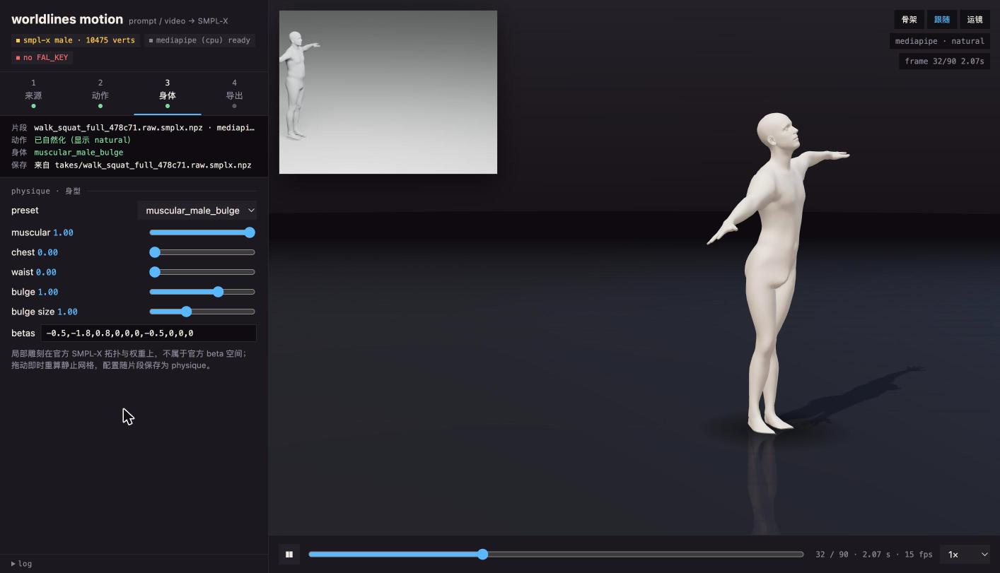

# Worldlines Motion

> **EN** · An open-source toolkit that turns a text prompt or a video into SMPL-X motion, cleans it up, sculpts the body (muscular, male bulge) and exports to Blender. Runs on a Mac with no GPU (MediaPipe path); plugs into a GVHMR worker for high quality. The browser workbench walks the same four stages as the CLI. Apache-2.0; model files are never redistributed.



把一句动作描述或一段视频变成 SMPL-X 动作的工具包。整个生产流程只有四步，命令行、Python 包和浏览器工作台都按这四步组织：

```
 ① 来源 source        ② 动作 motion         ③ 身体 body           ④ 导出 export
 prompt → fal 视频     naturalize            physique              Blender 插件 .npz
 视频 → GVHMR/MediaPipe  平滑·关节限位·贴地·脚锁   肌肉·凸起·胸·腰·betas    全蒙皮 rig · 网格缓存 · 审片渲染
 片段库 / 程序化片段
            └──────────── worldlines.smplx_motion.v1 片段在四步之间流转 ────────────┘
```

核心思路来自 [prompt2rig](https://github.com/blendi-remade/prompt2rig)（文生视频 + GVHMR 提动作 + 浏览器实时回放，Apache-2.0）。这里把目标骨架从 Mixamo 换成官方 SMPL-X，把动作数据固定为本项目的片段格式，并补上动作清理、身型雕刻和一条 Mac 就能闭环的视频解算。

## 生产流程

**① 来源。** 三个入口，产出都是一条片段。

- **文字**：`source/prompt.py` 复用 prompt2rig 的做法，先用 FLUX 生成一张正面站立的"演员"图，再用 H3 Max Turbo 或 FLUX 3 Max 让这个演员做动作，提示词里固定机位、全身入画、不转身。需要 `.env` 里的 `FAL_KEY`。
- **视频**：`source/video.py` 自动选后端。GVHMR worker（`source/gvhmr_worker/`，prompt2rig 的 `hq/` 原样移植，CUDA，本机或远程）质量高；没有 CUDA 时落到 MediaPipe 解算（`source/mediapipe_solver.py` 取世界关键点，`source/landmarks_to_smplx.py` 逐骨对准到 SMPL-X 骨架求局部轴角，根位移由二维髋点折算，没有深度）。MediaPipe 的输出在提取时就贴地，但抖动、脚滑和关节越界留给第二步。
- **片段库**：`takes/` 里保存过的片段，或 `demos/clips/` 的程序化测试片段（`source/procedural.py`，不需要模型文件）。

**② 动作。** `naturalize.py` 是一串可单独开关的纯函数：四元数空间的速度自适应平滑（快动作少平滑，保留冲击）、关节范围软钳制（膝肘铰链方向、髋肩范围）、地面估计与防穿地、触地检测加分段式根位移修正消脚滑、首尾收束、可选呼吸。`metrics()` 给出抖动、脚滑、穿地等数字，工作台里 raw / natural 并排显示并可来回切换。

**③ 身体。** `physique.py` 在官方拓扑与蒙皮权重之上做区域雕刻：`muscular`（胸背加宽、收腰、三角肌与上臂）、`bulge`（男性裆部凸起，位置由两髋关节定位，沿法线与前方推出，`bulge_size` 控制范围）、`chest`、`waist`，再叠加十个 `betas`。配置以 `physique` 字段随片段保存，导出时按它重建；这些雕刻不属于官方 beta 空间。预设：`neutral`、`muscular_male`、`male_bulge`、`muscular_male_bulge`。

**④ 导出。** `export/blender_addon.py` 写官方 SMPL-X Blender 插件可导入的 `.npz`（Format 选 AMASS）；`export/blender_rig.py` 生成全蒙皮的本机 rig 数据（官方网格、权重、逐帧姿态修正，顶点误差约 1 微米，需要 torch 与 smplx）；`export/mesh.py` 烘焙逐帧顶点与头发附件数据；`render_soft.py` 做无依赖的审片渲染。

贯穿四步的是 `clip.py` 定义的片段格式 `worldlines.smplx_motion.v1`（`transl[T,3]`、`global_orient[T,3]`、`body_pose[T,63]`、`betas[10]`、`fps`，可选手部、下颌、触地、`physique`、`naturalize` 等字段）和 `smplx_model.py` 的 numpy 版 SMPL-X 蒙皮（含姿态修正，与上游 `smplx.lbs` 顶点差约 2e-7 米，不需要 torch）。

## 安装与模型

```sh
python3 -m pip install -e ".[video]"      # 或 uv venv && uv pip install -e ".[video]"
cp .env.example .env                      # 需要文字入口时填 FAL_KEY；远程 worker 填 GVHMR_WORKER_URL
```

模型文件按 `SMPLX_MODEL` 环境变量、`models/SMPLX_MALE.npz`、`~/Downloads/SMPLX_MALE.npz` 的顺序查找，请从 [SMPL-X 官网](https://smpl-x.is.tue.mpg.de/)自行注册下载。MediaPipe 的 `.task` 文件首次使用时自动下到 `models/`。GVHMR worker 的安装见 `worldlines_motion/source/gvhmr_worker/README.md`。

## 工作台

```sh
wlmotion workbench        # http://127.0.0.1:5190
```

左栏顶部是四个步骤页签，一次只看一步；下面一条状态栏随时显示当前片段走到了哪里（来源、是否自然化、身型、保存位置），完成的步骤会亮绿点。主区域是 three.js 舞台，SMPL-X 网格在浏览器里做 CPU 蒙皮，服务器只发送本机许可模型算出的静止网格、面、关节和稀疏权重，不复制模型文件。底部是播放条；空格播放暂停，左右键逐帧，数字键 1–4 切步骤。

从视频或文字提取完成后自动跳到第 ② 步；拖身型滑块即时重算静止网格；第 ④ 步保存的是当前显示的版本和当前身型。服务端 `workbench/server.py` 是纯标准库，`/api/model`、`/api/clip`、`/api/naturalize`、`/api/video_to_motion`、`/api/prompt_to_motion`、`/api/save`、`/api/export/blender` 也可以被脚本直接调用。舞台和任务轮询来自 prompt2rig 的 `stage.js` 与 `app.js`。

## 命令行

`wlmotion` 的子命令按同样四步分组，`wlmotion --help` 可见：

```sh
# ① 来源
wlmotion prompt "does jumping jacks" -o takes/ --preset muscular_male_bulge
wlmotion video clip.mp4 -o takes/clip.smplx.npz          # 自动选 gvhmr / mediapipe，顺带自然化
wlmotion procedural walk_squat takes/walk_squat.smplx.npz
# ② 动作
wlmotion naturalize in.npz out.npz --breathing 0.5
# ③ 身体
wlmotion physique in.npz out.npz --preset muscular_male --bulge 1.2 --bulge-size 1.3
# ④ 导出
wlmotion blender out.npz out.blender_smplx.npz
wlmotion rig out.npz demos/local-smplx/out --profile '{"muscular":1,"bulge":1}'
wlmotion mesh out.npz out_dir --step 2                    # smplx_animation.npz + hair_attachment.json
wlmotion render out.npz frame.png --frame 60
```

## 仓库结构

```
worldlines_motion/
  clip.py  smplx_model.py  render_soft.py     基础：片段格式、numpy 蒙皮、软渲染
  source/        ① 来源   prompt.py video.py gvhmr_client.py gvhmr_worker/ mediapipe_solver.py landmarks_to_smplx.py fal_video.py procedural.py
  naturalize.py  ② 动作
  physique.py    ③ 身体
  export/        ④ 导出   blender_addon.py blender_rig.py blender_import.py mesh.py
  workbench/     浏览器工作台（server.py + public/）
  cli.py         wlmotion
tests/           新代码的测试
demos/clips/     程序化测试片段与预览视频；demos/synthetic-lbs/、demos/blender/ 是不依赖官方模型的格式与时序基线
legacy/          0.1 时代的脚本，原样冻结，只为复现 demos/（见 legacy/README.md）
takes/           工作台和命令行的产出，不入库
```

## 已验证的结果（2026-10-25）

用本机 Blender 渲染的 SMPL-X 深蹲视频做闭环：MediaPipe `full` 模型 90 帧约 16 秒解算，蹲起时序被正确恢复；自然化后抖动指标 0.89 → 0.49，触地脚滑 0.073 → 0.039 m/s，穿地 1.9 m → 0.014 m。肩关节的轴角误差偏大是扭转不可观测所致，渲染看不出问题。

| 后端 | 运行环境 | 根位移 | 手指 | 质量 |
|---|---|---|---|---|
| GVHMR worker | CUDA，本机或远程 | 重力对齐的世界轨迹 | WiLoR 可选 | 高 |
| MediaPipe 解算 | Mac / CPU | 二维髋点折算，无深度 | 无 | 预览级 |

```sh
PYTHONPATH=. python3 -m unittest discover -s tests -t .                 # 片段格式、身型、自然化、解算、导出、工作台接口
```

尚未在本机验证的两条路：fal 文生视频（没有 key）和 GVHMR worker（没有 CUDA）；两者的协议都按 prompt2rig 原样实现并有单元测试覆盖转换部分。

## 许可边界

代码按 Apache-2.0 开源（见 `LICENSE`、`NOTICE`）。本项目是非营利的开源项目，链路上的第三方件都在它们的使用范围内：GVHMR 允许教育、研究与非营利使用，SMPL-X、WiLoR、MANO 为非商业许可，Ultralytics YOLO 为 AGPL-3.0，fal 上的视频模型按各自条款。

唯一的硬规则是**不随仓库再分发模型文件和派生几何**：`SMPLX_*.npz`、MANO、GVHMR/WiLoR 权重须由每位使用者自行注册获取，`.gitignore` 排除了 `models/`、`takes/`、`demos/local-smplx/` 与 worker 的权重目录；工作台只在本机内存里把许可模型算成静止网格发给浏览器，不写盘也不入库。
